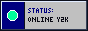
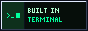

<div align="center">
  
  <br />
  
</div>

<div align="center">
  <br />
  <code>C:\USERS\PAULINOPAUL&gt;</code>
  <kbd>TELECOM</kbd> · <kbd>IOT</kbd> · <kbd>DEEP LEARNING</kbd> · <kbd>AGENT SYSTEMS</kbd> · <kbd>TECH ETHICS</kbd>
</div>

<br />

<div align="center">
  
</div>

## `01 // USER_PROFILE.DAT`

```text
> whoami
Telecom Student passionate about IoT, deep learning,
agent-based systems, and a future grounded in technological ethics.
```

<!-- ==================== PERSONAL DATA: EDIT BELOW ==================== -->

| Field | Value |
| :--- | :--- |
| **Handle** | `@paulinopaul` |
| **Languages** | `<!-- TODO: e.g., Spanish (Native), English (Fluent) -->` Spanish & English |
<br />

<div align="center">
  
</div>

## `02 // WORKSPACE_PRO.E`

<!-- ==================== PROFESSIONAL DATA: FILL BELOW ==================== -->
<!-- Tip: Replace bracketed placeholders [like this] with your experience, education, and stack. -->

### `> ABOUT_ME.TXT`

> *[TODO: Add a 2–3 line professional summary — your academic specialization, engineering focus, and the kind of problems or roles you are targeting.]*

### `> EDUCATION_&_CERTS.LOG`

| Program / Certification | Institution | Period | Focus / Highlights |
| :--- | :--- | :--- | :--- |
| **Telecommunications Engineering** *(In Progress)* | *[University Name]* | *[YYYY – Present]* | *[Key coursework, thesis, or lab focus]* |
| *[Certification / Course]* | *[Issuer / Platform]* | *[YYYY]* | *[Relevant credential or specialization]* |

### `> EXPERIENCE_&_RESEARCH.DAT`

- **`[Role / Research Position]`** @ *[Organization / Lab / Company]* (`[MMM YYYY – MMM YYYY]`)
  - *[TODO: Describe what you built, measured, or researched (protocols, models, hardware, or impact).]*
- **`[Role / Freelance / Internship]`** @ *[Organization / Project]* (`[MMM YYYY – MMM YYYY]`)
  - *[TODO: Add key technical contribution or outcome.]*

### `> TECH_STACK_&_HARDWARE.CFG`

| Domain | Stack & Tools |
| :--- | :--- |
| **Languages** | <kbd>Python</kbd> <kbd>C++</kbd> <kbd>Lua</kbd> <kbd>QML</kbd> *[+ Add more]* |
| **IoT & Telecom** | *[e.g., ESP32, STM32, MQTT, RF / SDR, Embedded Linux]* |
| **AI & Agents** | *[e.g., PyTorch, Deep Learning, Multi-Agent Systems, LLMs]* |
| **Systems & Tooling** | *[e.g., Linux, Git, Docker, Neovim, KiCad]* |

<br />

<div align="center">
  
</div>

## `03 // C_PROJECTS_DIR`

<!-- Pre-linked from your public GitHub repositories — add 1-line summaries & highlights below -->

| Directory | Primary Tech | Summary & Impact |
| :--- | :--- | :--- |
| [`C:\PROJECTS\robot_sumo_usando_agentes_ia`](https://github.com/paulinopaul/robot_sumo_usando_agentes_ia) | <kbd>C++</kbd> | *[TODO: Describe robot architecture, agent logic, sensors, or competition results.]* |
| [`C:\PROJECTS\quickshell-cocoa`](https://github.com/paulinopaul/quickshell-cocoa) | <kbd>QML</kbd> | *[TODO: Describe your custom desktop shell / UI concept and features.]* |
| [`C:\PROJECTS\obsidian-context`](https://github.com/paulinopaul/obsidian-context) | <kbd>Python</kbd> | *[TODO: Describe knowledge-graph / context automation workflow.]* |
| [`C:\PROJECTS\dotfiles`](https://github.com/paulinopaul/dotfiles) | <kbd>Lua</kbd> | *[TODO: Describe your Neovim / Linux / terminal environment setup.]* |
| *`C:\PROJECTS\next-featured-project`* | <kbd>TBD</kbd> | *[TODO: Add upcoming professional or research project + link.]* |

<br />

<div align="center">
  
</div>

## `04 // NET_LINKS.HTML`

<!-- ==================== CONTACT & LINKS: EDIT BELOW ==================== -->

<div align="center">

| Channel | Link |
| :--- | :--- |
| **LinkedIn** | *[Add LinkedIn URL]* |
| **Portfolio / CV** | *[Add Portfolio or Resume URL]* |
| **Email** | *[Add public contact email]* |
| **Other Social** | *[Add X / Discord / Mastodon / etc.]* |

<br />






<br /><br />

<sub><code>SYSTEM READY // Y2K INTERFACE v2.000 // @PAULINOPAUL</code></sub>

</div>
