<div align="center">
  
  <br />
  
</div>

<div align="center">
  <br />
  <code>C:\USERS\PAULINOPAUL&gt;</code>
  <kbd>TELECOM</kbd> · <kbd>IOT</kbd> · <kbd>DEEP LEARNING</kbd> · <kbd>AGENT SYSTEMS</kbd> · <kbd>TECH ETHICS</kbd>
</div>

<br />

<div align="center">
  
</div>

## `01 // USER_PROFILE.DAT`

```text
> whoami
Telecom Student passionate about IoT, deep learning,
agent-based systems, and a future grounded in technological ethics.
```

| Field | Value |
| :--- | :--- |
| **Handle** | `@paulinopaul` |
| **Languages** | Spanish & English |

<br />

<div align="center">
  
</div>

## `02 // WORKSPACE_PRO.EXE`

### `> ABOUT_ME.TXT`

> Telecommunications Engineering student focused on Artificial Intelligence, Satellite and Wireless Communications, and IoT.

### `> EDUCATION.LOG`

| Program | Institution | Period | Focus |
| :--- | :--- | :--- | :--- |
| **B.S. in Telecommunications Engineering** | UNMSM | 2024 – Present | IoT, Wireless Networks, Electronics, Machine Learning |

### `> EXPERIENCE_&_RESEARCH.DAT`

- **`Embedded Systems Engineer`** @ *OrionTel CubeSat 1U Project* (`Dec 2025 – Present`)
  - Structural and payload design for a 1U CubeSat competing in CNPS 2025; `ESP32-S3` telemetry (`BME280/BME680`, `MPU-6050`, `NEO-8M` GPS, `LTR390` UV), `LoRa RFM95/SX1278` orbital comms, and parachute recovery.
- **`Robotics Developer`** @ *Autonomous Laboratory Robot Project* (`Oct 2026 – Present`)
  - Autonomous lab logistics robot built on `ESP32` and `ToF` sensors for real-time spatial mapping, obstacle avoidance, and on-board AI navigation.
- **`Project Lead / Developer`** @ *Hardware & Firmware Development (UNMSM)* (`Apr 2026 – Sep 2026`)
  - Engineered a `FreeRTOS`/`C++` embedded node with `LSTM` models for real-time landslide prediction in Chosica, and a 3D-printed `ESP32-S3` Wi-Fi wearable AI assistant pin interfacing with cloud LLM APIs.

### `> TECH_STACK_&_HARDWARE.CFG`

| Domain | Stack & Tools |
| :--- | :--- |
| **Languages** | <kbd>C++</kbd> <kbd>Python</kbd> <kbd>Golang</kbd> <kbd>Rust</kbd> <kbd>Lua</kbd> <kbd>QML</kbd> |
| **IoT, RF & Embedded** | `ESP32 / ESP32-S3`, `FreeRTOS`, `LoRaWAN / RFM95`, `MQTT`, `ToF Sensors` |
| **AI & Telemetry** | `Deep Learning`, `Computer Vision`, `LSTM`, `Cloud LLM APIs` |
| **Hardware & Systems** | `Linux`, `Git`, `SMD Micro-soldering`, `Circuit Board Diagnosis`, `Cloud Computing` |

<br />

<div align="center">
  
</div>

## `03 // C_PROJECTS_DIR`

| Directory | Primary Tech | Summary & Impact |
| :--- | :--- | :--- |
| [`C:\PROJECTS\robot_sumo_usando_agentes_ia`](https://github.com/paulinopaul/robot_sumo_usando_agentes_ia) | <kbd>C++</kbd> | Autonomous & teleoperated 2WD Sumo robot on `ESP32` (`ESP-NOW` 2.4 GHz, `Bluetooth SPP`, `Wokwi` sim) developed with AI-agent workflows. |
| [`C:\PROJECTS\quickshell-cocoa`](https://github.com/paulinopaul/quickshell-cocoa) | <kbd>QML</kbd> | Modular, reactive Wayland desktop shell for `Hyprland` built with `Quickshell` (`Qt6`/`QML`) and 206 passing tests. |
| [`C:\PROJECTS\obsidian-context`](https://github.com/paulinopaul/obsidian-context) | <kbd>Python</kbd> | Zero-dependency Agent Skill for persistent engineering memory, ADRs, and Obsidian Graph View `[[wikilinks]]`. |
| [`C:\PROJECTS\dotfiles`](https://github.com/paulinopaul/dotfiles) | <kbd>Lua</kbd> | Modular Arch Linux & `Hyprland` desktop dotfiles (`Ghostty`, `Caelestia`, symlinked config architecture). |

<br />

<div align="center">
  
</div>

## `04 // NET_LINKS.HTML`

<div align="center">

| Channel | Link |
| :--- | :--- |
| **GitHub** | [@paulinopaul](https://github.com/paulinopaul) |
| **LinkedIn** | [paul-angelo-landeo-aucapina](https://www.linkedin.com/in/paul-angelo-landeo-aucapina/) |

<br />


<br /><br />

<sub><code>SYSTEM READY // Y2K INTERFACE v2.000 // @PAULINOPAUL</code></sub>

</div>
